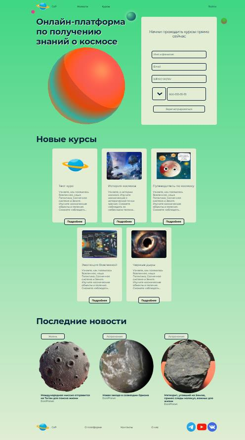

# 🪐 CoursOfPlanet — тема WordPress для сайта о космосе

Кастомная тема WordPress для образовательного портала **CoursOfPlanet**: каталог онлайн-курсов по астрономии и астрофизике, новости о космосе, регистрация и личный профиль пользователя.

Проект выполнен как курсовая работа по дисциплине «Веб-программирование» (Брянский государственный технический университет, факультет информационных технологий, 2024). Тема на тему: «Разработка сайта с курсами по космосу».



## 📖 О проекте

Интерес к космосу и онлайн-образованию растёт, а WordPress остаётся самой популярной CMS (по статистике ITrack и 2ip, на которые опирается курсовая). Поэтому сайт сделан именно на нём: тема написана с нуля, без готовых шаблонов, а контент (курсы, новости, меню, виджеты) редактируется из админ-панели.

**Что умеет сайт:**

- публиковать **новости** о космосе с фильтрацией по категориям и поиском;
- показывать **каталог курсов** с фильтрами по направлению и уровню сложности;
- отдельная страница каждого курса: чему научится студент, сколько займёт времени, как проходит обучение;
- **регистрация и авторизация** пользователей, личный профиль и настройки;
- страницы «О нас», «О платформе», «Контакты»;
- форма **оценки сайта** (отправка через AJAX);
- интерактивные элементы: 3D-планета, видео, анимации планет.

## 🧱 Технологии

- **WordPress** + PHP — кастомная тема
- **HTML5** — семантическая вёрстка (`header`, `main`, `section`, `article`, `aside`, `nav`, `figure`, `picture`, `video`, `audio`, `canvas`, `dialog`, `progress`, `meter`, `details` и др.)
- **CSS3** — Flexbox, анимации, `transform`, градиенты (в т. ч. повторяющиеся), `border-image`, `text-shadow`
- **JavaScript** — 3D-модель планеты, всплывающее окно авторизации, управление видео, AJAX-запросы
- **Figma** — прототипы и макеты
- Шрифт **Montserrat**

## 🗂️ Структура репозитория

```
Site-theme-WordPress/
├── Css/                    # стили отдельных страниц
├── script/                 # JavaScript (moduleearth.js, video.js, ajax.js и др.)
├── Img/                    # изображения для страниц
├── Othercontent/           # дополнительные материалы
├── style.css               # главный файл стилей + заголовок темы
├── functions.php           # функционал темы
├── header.php / footer.php # шапка и подвал
├── front-page.php          # главная страница
├── page-about.php          # «О нас»
├── page-aboutplatform.php  # «О платформе»
├── page-contact.php        # «Контакты»
├── page-cours.php          # каталог курсов
├── single-cours.php        # страница курса
├── page-news.php           # каталог новостей
├── single.php              # страница новости
├── category.php            # категории новостей
├── page-login.php          # авторизация
├── page-registration.php   # регистрация
├── page-profile.php        # профиль
├── page-profilesetting.php # настройки профиля
├── admin-post.php          # обработка форм
└── 404.php                 # страница ошибки
```

## ⚙️ Возможности `functions.php`

- Регистрация и подключение стилей и скриптов (`wp_register_style/script`, `wp_enqueue_style/script`, `wp_style_add_data`, `wp_localize_script`) с версией темы для сброса кэша.
- Отключение лишних скриптов и стилей (`wp_deregister_script`, `wp_deregister_style`).
- Настройка темы: поддержка логотипа, миниатюр, меню WordPress (шапка и подвал).
- Собственный **тип записей `cours`** (курсы) и две таксономии: **«Направление»** (иерархическая) и **«Уровень сложности»** (плоская).
- Собственный **статус записей «На проверке»** (`register_post_status`).
- **Виджет соцсетей** в подвале.
- Обработка AJAX с защитой: `wp_create_nonce`, `check_ajax_referer`, `wp_verify_nonce`, `wp_nonce_field`; безопасность данных — `wp_kses_post`, `wp_hash_password`, `wp_generate_password`.

## 🚀 Установка

1. Установите WordPress (например, через XAMPP, OpenServer или Local).
2. Склонируйте репозиторий в папку тем:
   ```bash
   cd wp-content/themes
   git clone https://github.com/Chaykaman/Site-theme-WordPress.git CoursOfPlanet
   ```
3. В админ-панели откройте **Внешний вид → Темы** и активируйте **CoursOfPlanet**.
4. Создайте страницы с нужными шаблонами (slug: `about`, `aboutplatform`, `contact`, `cours`, `news`, `login`, `registration`, `profile`, `profilesetting`).
5. Настройте меню в **Внешний вид → Меню** (расположения: главное меню и меню подвала).
6. Добавьте курсы в разделе «Курсы» и новости в разделе «Записи».

## 🎨 Дизайн

Логотип в виде планеты и название «CoursOfPlanet» отражают тематику сайта. Цветовая схема: тёмно-синий (текст), зелёный и бежевый (фон), тёмно-бежевый (акценты). Размеры шрифта: 16 px (текст), 24 px (заголовки блоков), 54 px (заголовок страницы).
